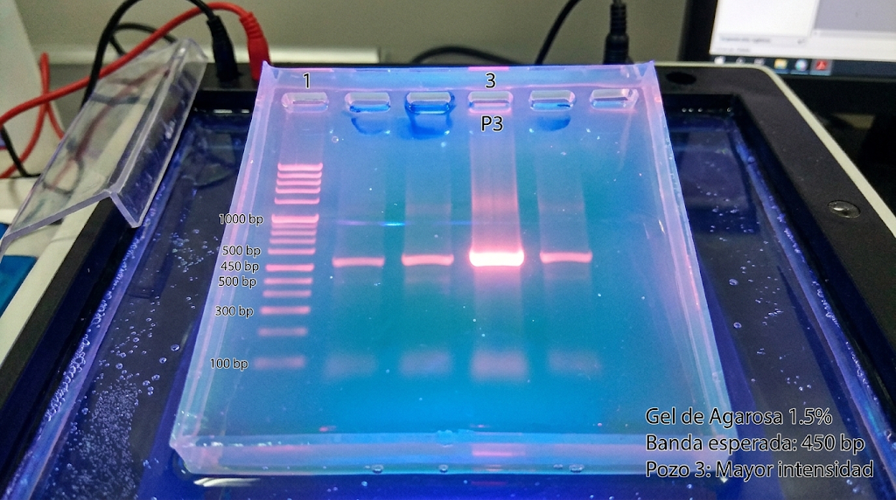

# EXP-2026-042: Transfection Efficiency Verification by PCR

## 1. Objective
Evaluate the target gene amplification percentage after 48h of transfection with the pCas9-sgRNA plasmid.

[Look documentation](/ref/molecular_biology_lab_documentation_research_report_architecture_strategy.md)

## 2. Linked Materials and Reagents
- **Cells:** HeLa Line (Lot `#HL-202603-B`, Aliquot B2)
- **Plasmid:** `pCas9-sgRNA_TargetA` (Concentration: 250 ng/µL)
- **Taq Polymerase:** Promega (Lot `#00004921`)

## 3. PCR Protocol
| Component | Volume (1 sample) | Volume (Master Mix 5x) |
| :--- | :--- | :--- |
| 10X Buffer | 2.5 µL | 12.5 µL |
| dNTPs (10 mM) | 0.5 µL | 2.5 µL |
| Forward Primer (10 µM) | 1.0 µL | 5.0 µL |
| Reverse Primer (10 µM) | 1.0 µL | 5.0 µL |
| Template DNA | 2.0 µL | N/A (Add individually) |
| Nuclease-Free H2O | 17.8 µL | 89.0 µL |

> ⚠️ **Process Note:** Buffer incubation at room temperature for 5 min before resuspending.

## 4. Results and Images

*Expected band at 450 bp. Well 3 shows higher intensity.*

## 5. Signatures and Traceability
- **Recorded by:** Dr. Elena Ruiz (2026-10-26 17:30 UTC)
- **SHA-256 File Hash:** `e3b0c44298fc1c149afbf4c8996fb92427ae41e4649b934ca495991b7852b855`

## 6. Sources

[Go to Google](https://www.google.com)

<https://www.google.com>