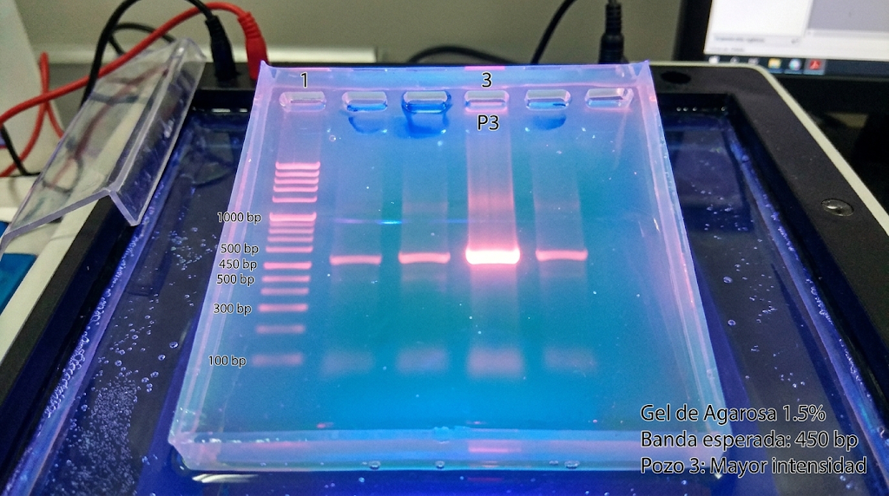

# EXP-2026-042: Verificación de Eficiencia de Transfección por PCR

## 1. Objetivo
Evaluar el porcentaje de amplificación del gen objetivo tras 48h de transfección con plásmido pCas9-sgRNA.

[Ver Resumen Ejecutivo](/ref/documentaci_n_en_laboratorios_de_biolog_a_molecular_un_resumen_ejecutivo.md)

## 2. Materiales y Reactivos Vinculados
- **Células:** Linea HeLa (Lote `#HL-202603-B`, Alícuota B2)
- **Plásmido:** `pCas9-sgRNA_TargetA` (Concentración: 250 ng/µL)
- **Taq Polymerase:** Promega (Lote `#00004921`)

## 3. Protocolo de PCR
| Componente | Volumen (1 muestra) | Volumen (Master Mix 5x) |
| :--- | :--- | :--- |
| Buffer 10X | 2.5 µL | 12.5 µL |
| dNTPs (10 mM) | 0.5 µL | 2.5 µL |
| Primer Forward (10 µM) | 1.0 µL | 5.0 µL |
| Primer Reverse (10 µM) | 1.0 µL | 5.0 µL |
| ADN Templado | 2.0 µL | N/A (Añadir individual) |
| H2O Libre de Nucleasas | 17.8 µL | 89.0 µL |

> ⚠️ **Nota de proceso:** Incubación del tampón a temperatura ambiente 5 min antes de resuspender.

## 4. Resultados e Imágenes

*Banda esperada a 450 bp. Pozo 3 muestra mayor intensidad.*

## 5. Firmas y Trazabilidad
- **Registrado por:** Dra. Elena Ruiz (2026-10-26 17:30 UTC)
- **SHA-256 Hash del archivo:** `e3b0c44298fc1c149afbf4c8996fb92427ae41e4649b934ca495991b7852b855`

## 6. Sources

[Ir a Google](https://www.google.com)

<https://www.google.com>